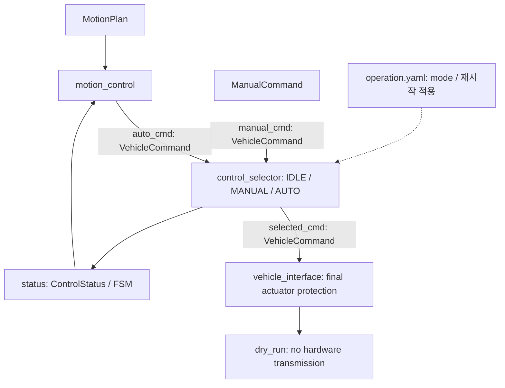

# Command path: control_selector + vehicle_interface

패키지 이름은 `control_manager`, arbitration node 이름은 `control_selector`입니다.
executable/source/header는 `control_selector_node` 이름을 사용합니다.

SelectedCommand는 별도 새 타입을 만들지 않고 `VehicleCommand`를 재사용합니다.
`selected_cmd`에서 actuator-facing 소유자는 vehicle_interface 하나입니다. 실제 UDP/CAN backend는 없습니다.
최종 보호 결과는 vehicle_interface 내부 값이며, 진단은 command input으로 사용하지 않습니다.

## 책임 이동

| 조건 | 현재 소유자 / 동작 |
|---|---|
| IDLE | control_selector가 steer/speed=0, brake=true를 선택 |
| AUTO / MANUAL | 해당 source만 선택; 다른 source fallback 없음 |
| source timestamp 형식 오류(sec < 0 / nanosec >= 10억), 수신/source timestamp timeout, frame | control_selector: stop, SOURCE_UNAVAILABLE |
| 선택 source valid=false | control_selector: zero/brake stop, INVALID_SOURCE_COMMAND |
| mode 변경 | operation.yaml 수정 후 selector 재시작; 새 source callback 필요 |
| 선택 명령 수신/source timestamp timeout, frame | vehicle_interface: selector 중단에도 자체 timer로 stop |
| NaN/Inf, brake+0이 아닌 속도 | vehicle_interface: INVALID_COMMAND_VALUES stop |
| 미검증/0 운용 한계 | vehicle_interface: OPERATING_LIMITS_NOT_VERIFIED stop |
| steering/speed 물리 범위 초과 | vehicle_interface: COMMAND_OUT_OF_RANGE stop; 기존 정책대로 clamp하지 않음 |
| GlobalPose validity/freshness | 기존 path_planning/motion_control에서 검사 |
| MotionState validity/freshness | 기존 motion_planning/motion_control에서 검사 |
| ObjectState freshness/validity/obstacle | 기존 motion_planning에서 AUTO 정지 판단 |

후단 두 node는 GlobalPose / MotionState / ObjectState를 구독하지 않습니다.
MANUAL은 해당 state/object와 독립적인 명령 선택입니다. obstacle emergency distance의 후단 중복 검사는
제거했습니다. 기존 motion_planning이 모든 detected obstacle에 정지하므로 추가 obstacle 알고리즘은 없습니다.
Motion Control은 vehicle.yaml의 조향 범위와 전진 속도 상한으로 AUTO 출력을 제한합니다.
Vehicle Interface는 같은 범위를 사용하며, 범위 내 음수 속도 명령도 허용합니다.
PID / Pure Pursuit 자동 경로 추종은 전진 전용입니다.

## 선택 명령 기준 FSM

ControlStatus는 mode와 selected_cmd만으로 생성합니다. Vehicle Interface 없이도 발행됩니다.
IDLE은 READY, valid 주행은 DRIVING, valid 정지는 STOPPED, invalid/만료 명령은 FAULT입니다.
reason은 선택 결과의 사유이며 header는 상태 발행 시각입니다.
Vehicle Interface의 범위 초과·만료 판단은 내부 보호와 기존 dry-run 로그로 남습니다.
그 결과를 Selector의 FSM이나 Motion Control로 되돌리지 않습니다.
Motion Control의 PID 이력 및 종점 통과 판정은 선택 명령 기준 FSM으로 동작합니다.
DRIVING은 명령 상태이며 실측 차량 운동이나 최종 보호 통과를 뜻하지 않습니다.

## Breaking changes / 제거 항목

- `control_manager_node` executable/source/header → `control_selector_node`.
- ROS node 및 YAML `/control/control_manager` → `/control/control_selector`.
- `src/safety_limit_node.cxx`, `SafetyLimitNode` header 선언, executable `safety_limit_node`, launch 항목 제거.
- `/control/safety_limit` YAML section 제거. `operating_limits_verified`는 `/control/vehicle_interface`에서 설정.
  조향각·속도 범위는 `vehicle.yaml`의 `vehicle.limits`에만 두며 Motion Control / Vehicle Interface가 공유.
- `/control/final_cmd` 및 `topics.final_cmd` 제거. 외부 source 검색에서 compatibility 의존성 없음.
- `require_obstacle_state`, `emergency_distance_m`, 후단 전용 `object_timeout_s` 설정 제거.
- 기존 `SafetyConfig` / `applySafety`는 상태·장애물 입력 없는 `ActuatorProtectionConfig` / `protectActuatorCommand`로 교체.
- 기존 final command subscriber는 필요에 따라 새 **진단 타입**을 구독하도록 별도 이행해야 함. 호환 alias 없음.
- MANUAL의 localization/object gate 제거는 의도된 정책 변경이며 state 판단은 AUTO planning/control의 책임.

Vehicle Control mode는 operation.yaml에서 시작 시 선택합니다. `/control/mode_request` 구독은 제거했으며,
read-only mode 변경은 selector 재시작으로 적용합니다. 시작값 오류는 fallback 없이 시작 오류입니다.
현재 operation.yaml은 GNSS AUTO 테스트용으로 `mode: AUTO`이며, YAML 없이 실행할 때의 fallback은 IDLE입니다.
manual_cmd 입력 연결은 보류하며 AUTO에서는 수동 입력이 없어도 자동 명령을 선택합니다.
두 입력 구독은 유지하며 시간 변환 전에 형식을 검사합니다. 잘못된 수동 timestamp도 AUTO를 중단시키지 않습니다.

유지: `/control/auto_cmd`, `/control/manual_cmd`, `/control/selected_cmd`,
`/control/status`, 모든 planning/tracking/state topic과 message.
`/control/estop` 구독·설정·내부 상태·보호 함수 인자는 제거했습니다. Vehicle Interface 입력은 selected_cmd 하나입니다.
`/control/vehicle_interface/status` 발행·구독·설정과 VehicleInterfaceStatus 메시지 생성은 제거했습니다.
msg/VehicleInterfaceStatus.msg 파일은 과거 정의로 보관합니다.
현재 executable 11개 / custom message 10개 (지도 파일 제공자 포함). `dry_run=true`, PID 비활성/0 gain 유지.
역사적 원문 `doc/2_셋업프롬프트.txt`는 현행 launch/config 지시가 아닙니다.

## 검증

`test/command_path_smoke_test.py`는 AUTO/MANUAL 선택·timeout·timestamp 형식/신선도 거부·복구·수동 입력 없는 AUTO·invalid source·IDLE,
선택 명령 기준 FSM·제거된 estop 토픽의 publisher/subscriber 부재·selector 종료·직접 주입한 비정상 SelectedCommand·범위 초과를 검증합니다.
최종 보호는 기존 dry-run 로그를 읽어 확인하며 테스트 전용 진단 토픽은 만들지 않습니다.
GTest는 최종 보호의 NaN/Inf/후진 범위/제동 모순/한계/timeout과 원본 timestamp 보존을 검증합니다.
기존 pipeline/state split/tracking/ingress/estimator smoke는 현재 연결로 갱신합니다.
실행 방법은 README의 package-only build/test 환경을 사용하며 모든 fixture와 출력은 package 내부입니다.

2026-10-15 검증 결과:

- ROS 2 Humble package-only clean configure/build 및 최종 install 갱신 성공.
- GTest 36개 / CTest 4개: 총 40 tests, 0 errors, 0 failures, 0 skipped.
- smoke 6개 suite / 350개 확인 항목 통과: command path 47, pipeline 69,
  tracking 59, state split 72, ingress 49, estimator modes 54.
- executable 10개와 XML/YAML 경로, custom message 12개 생성 확인.
  삭제한 executable/header는 clean install에서 제거되었으며 stale launch/config 항목 없음.
- Motion Planning / Motion Control / PID / PP / path geometry / tracking / state estimation 및
  vehicle.yaml은 시작 시점 source snapshot과 byte-for-byte 동일함을 확인.
- git diff --check 통과. 기존 이름은 이 제거 이력과 명시적으로 보관한 과거 요구사항에만 남음.
- 테스트 결과: log/selector_*_smoke_result.txt, build/control_manager/test_results/.
- 시작 시점 source: log/selector_before_sources.json; 변경 목록: log/selector_changed_files.txt.
- WRITE SCOPE: 외부 39,697개 항목의 mode/size/mtime_ns/SHA256/symlink target과 외부 Git 상태·diff가 동일.
  log/guidance_audit/selector_before.json / selector_after.json 비교 결과
  EXTERNAL_CHANGES [] / EXTERNAL_GIT_CHANGES []. **Modified files outside control_manager: 0**.
  기존 외부 변경 및 과거 미복구 symlink 상태는 보존했습니다.
