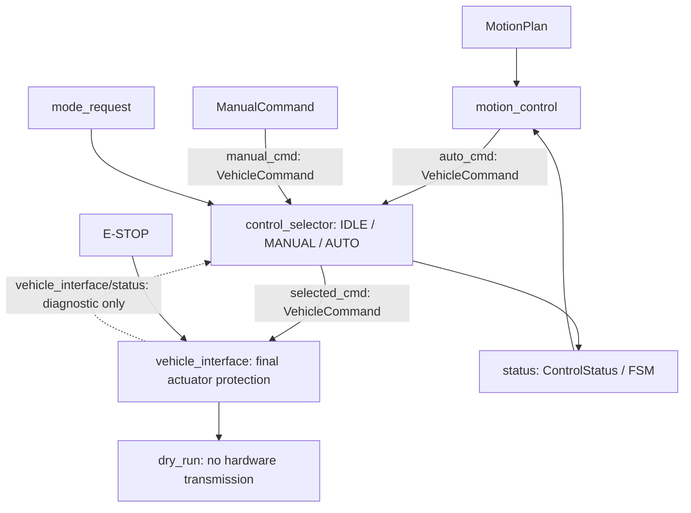

# Command path: control_selector + vehicle_interface

패키지 이름은 `control_manager`, arbitration node 이름은 `control_selector`입니다.
executable/source/header는 `control_selector_node` 이름을 사용합니다.

SelectedCommand는 별도 새 타입을 만들지 않고 `VehicleCommand`를 재사용합니다.
`selected_cmd`에서 actuator-facing 소유자는 vehicle_interface 하나입니다. 실제 UDP/CAN backend는 없습니다.
최종 보호 결과는 vehicle_interface 내부 값이며, 진단은 command input으로 사용하지 않습니다.

## 책임 이동

| 조건 | 현재 소유자 / 동작 |
|---|---|
| IDLE | control_selector가 steer/speed=0, brake=true를 선택 |
| AUTO / MANUAL | 해당 source만 선택; 다른 source fallback 없음 |
| source 수신/source timestamp timeout, frame | control_selector: stop, SOURCE_UNAVAILABLE |
| 선택 source valid=false | control_selector: zero/brake stop, INVALID_SOURCE_COMMAND |
| mode 전환 | 캐시 초기화, MODE_CHANGED stop 후 새 source callback 필요 |
| 선택 명령 수신/source timestamp timeout, frame | vehicle_interface: selector 중단에도 자체 timer로 stop |
| E-STOP | vehicle_interface: true는 explicit false까지 유지, 모든 mode와 invalid command보다 우선 |
| NaN/Inf, 음수 속도, brake+양의 속도 | vehicle_interface: INVALID_COMMAND_VALUES stop |
| 미검증/0 운용 한계 | vehicle_interface: OPERATING_LIMITS_NOT_VERIFIED stop |
| steering/speed 물리 범위 초과 | vehicle_interface: COMMAND_OUT_OF_RANGE stop; 기존 정책대로 clamp하지 않음 |
| GlobalPose validity/freshness | 기존 path_planning/motion_control에서 검사 |
| MotionState validity/freshness | 기존 motion_planning/motion_control에서 검사 |
| ObjectState freshness/validity/obstacle | 기존 motion_planning에서 AUTO 정지 판단 |

후단 두 node는 GlobalPose / MotionState / GuidanceStatus / ObjectState를 구독하지 않습니다.
MANUAL은 해당 state/object와 독립적인 명령 선택입니다. obstacle emergency distance의 후단 중복 검사는
제거했습니다. 기존 motion_planning이 모든 detected obstacle에 정지하므로 추가 obstacle 알고리즘은 없습니다.
Motion Planning / Motion Control / PID / Pure Pursuit / estimation 알고리즘은 변경하지 않았습니다.

## 진단과 FSM

`/control/vehicle_interface/status` (`VehicleInterfaceStatus`) 필드:

- `header`: 진단 발행 시각과 base frame.
- `dry_run`: 항상 true. 실제 차량 feedback이나 송신 성공을 뜻하지 않음.
- `protected_command`: 최종 보호 결과. 정상 명령의 source stamp는 보존하며, stop은 판단 시각을 사용.

control_selector는 이 진단을 **FSM 관찰에만** 사용합니다. 명령 source 선택은 영향을 받지 않습니다.
따라서 기존 final-protection 기반 FAULT와 PID의 FAULT reset/preview 동작을 유지합니다.
진단 중단/만료 시 FSM은 FAULT이며 해당 진단이 새 actuator command로 재입력되지는 않습니다.
DRIVING은 여전히 명령 상태이며 실측 차량 운동을 뜻하지 않습니다.

## Breaking changes / 제거 항목

- `control_manager_node` executable/source/header → `control_selector_node`.
- ROS node 및 YAML `/control/control_manager` → `/control/control_selector`.
- `src/safety_limit_node.cxx`, `SafetyLimitNode` header 선언, executable `safety_limit_node`, launch 항목 제거.
- `/control/safety_limit` YAML section 제거. `operating_limits_verified`, `max_steer_rad`,
  `max_speed_mps`는 `/control/vehicle_interface`로 이동.
- `/control/final_cmd` 및 `topics.final_cmd` 제거. 외부 source 검색에서 compatibility 의존성 없음.
- `require_obstacle_state`, `emergency_distance_m`, 후단 전용 `object_timeout_s` 설정 제거.
- 기존 `SafetyConfig` / `applySafety`는 상태·장애물 입력 없는 `ActuatorProtectionConfig` / `protectActuatorCommand`로 교체.
- 기존 final command subscriber는 필요에 따라 새 **진단 타입**을 구독하도록 별도 이행해야 함. 호환 alias 없음.
- MANUAL의 localization/object gate 제거는 의도된 정책 변경이며 state 판단은 AUTO planning/control의 책임.

유지: `/control/auto_cmd`, `/control/manual_cmd`, `/control/mode_request`, `/control/selected_cmd`,
`/control/status`, `/control/estop`, 모든 planning/tracking/state topic과 message.
추가: `/control/vehicle_interface/status` 진단 토픽과 `VehicleInterfaceStatus.msg`.
현재 executable 10개 / custom message 12개. `dry_run=true`, PID 비활성/0 gain, 미검증 한계 0 유지.
역사적 원문 `doc/2_셋업프롬프트.txt`는 현행 launch/config 지시가 아닙니다.

## 검증

`test/command_path_smoke_test.py`는 AUTO/MANUAL 선택·timeout·invalid source·IDLE,
mode 독립 E-STOP/FSM·selector 종료·직접 주입한 비정상 SelectedCommand·범위 초과를 검증합니다.
GTest는 최종 보호의 NaN/Inf/음수/제동 모순/한계/timeout/E-STOP과 원본 timestamp 보존을 검증합니다.
기존 pipeline/state split/tracking/ingress/estimator smoke는 현재 연결로 갱신합니다.
실행 방법은 README의 package-only build/test 환경을 사용하며 모든 fixture와 출력은 package 내부입니다.

2026-10-15 검증 결과:

- ROS 2 Humble package-only clean configure/build 및 최종 install 갱신 성공.
- GTest 36개 / CTest 4개: 총 40 tests, 0 errors, 0 failures, 0 skipped.
- smoke 6개 suite / 350개 확인 항목 통과: command path 47, pipeline 69,
  tracking 59, state split 72, ingress 49, estimator modes 54.
- executable 10개와 XML/YAML 경로, custom message 12개 생성 확인.
  삭제한 executable/header는 clean install에서 제거되었으며 stale launch/config 항목 없음.
- Motion Planning / Motion Control / PID / PP / path geometry / tracking / state estimation 및
  vehicle.yaml은 시작 시점 source snapshot과 byte-for-byte 동일함을 확인.
- git diff --check 통과. 기존 이름은 이 제거 이력과 명시적으로 보관한 과거 요구사항에만 남음.
- 테스트 결과: log/selector_*_smoke_result.txt, build/control_manager/test_results/.
- 시작 시점 source: log/selector_before_sources.json; 변경 목록: log/selector_changed_files.txt.
- WRITE SCOPE: 외부 39,697개 항목의 mode/size/mtime_ns/SHA256/symlink target과 외부 Git 상태·diff가 동일.
  log/guidance_audit/selector_before.json / selector_after.json 비교 결과
  EXTERNAL_CHANGES [] / EXTERNAL_GIT_CHANGES []. **Modified files outside control_manager: 0**.
  기존 외부 변경 및 과거 미복구 symlink 상태는 보존했습니다.
