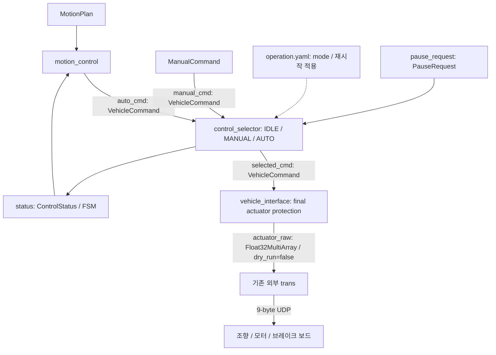

# Command path: control_selector + vehicle_interface

패키지 이름은 `control_manager`, arbitration node 이름은 `control_selector`입니다.
executable/source/header는 `control_selector_node` 이름을 사용합니다.



SelectedCommand는 별도 새 타입을 만들지 않고 `VehicleCommand`를 재사용합니다.
`selected_cmd`에서 actuator-facing 소유자는 vehicle_interface 하나입니다.
Vehicle Interface는 검사와 변환을 수행하고, 실제 패킷 조립·UDP 송신은 외부 `trans`를 재사용합니다.
최종 보호 결과는 vehicle_interface 내부 값이며, 진단은 command input으로 사용하지 않습니다.

## AUTO 일시정지 / 재개

`operation.yaml`의 `mode: AUTO`는 유지하며 `start_paused: true`가 기본입니다.
<!-- 출발/재개 전에는 유효 GNSS/경로가 있어도 selected_cmd가 조향 0 / 속도 0 / brake=true를 유지합니다. -->
출발/재개 전에는 유효 GNSS/경로가 있어도 selected_cmd가 마지막 유효 조향 / 속도 0 / brake=true를 유지합니다.
초기 지령 이력이 없을 때만 조향 0이며, 최종 Vehicle Interface에서도 보호를 통과한 마지막 조향을 유지합니다.
mode는 여전히 시작 시 고정이며 pause는 모드 선택과 독립적인 운용 요청입니다.

외부 입력 `/control/pause_request`는 `PauseRequest` (`Header header`, `bool pause`)입니다.
Control Selector가 수신하고 `/control/status`의 `paused`, `resume_sequence`로 Motion Control에 전달합니다.
요청 timestamp는 command_timeout_s 이내이고 정상 형식이어야 합니다. frame_id는 빈 문자열 또는 base_frame입니다.
이전에 받아들인 요청보다 오래되거나 동일한 timestamp는 거부합니다. 받아들인 pause는 요청 수신이 끊겨도 유지됩니다.
IDLE/MANUAL에서는 요청을 무시하며 기존 선택 동작을 유지합니다.

새로 빌드한 control_manager overlay를 source한 터미널에서 다음을 사용합니다.
`header: auto`는 ROS 2 CLI가 발행 시각으로 채웁니다. 반복 발행은 필요 없습니다.

```bash
# 출발 또는 재개
ros2 topic pub --once /control/pause_request control_manager/msg/PauseRequest "{header: auto, pause: false}"
# 일시정지
ros2 topic pub --once /control/pause_request control_manager/msg/PauseRequest "{header: auto, pause: true}"
# 수락 여부 및 최종 출력 확인
ros2 topic echo /control/status --once
ros2 topic echo /control/actuator_raw --once
```

일시정지 상태는 AUTO_PAUSED / STOPPED이며 최종 raw는 `[0, 0, 1]`입니다. 실제 정지 여부는 차량에서 확인합니다.
노드나 UDP 송신기를 종료하는 방식이 아니므로 재개할 때 경로 진행 위치를 잃지 않습니다.
Motion Control은 정지 중 진행 위치/구간 갱신을 멈추고 기존 진행 위치와 종점 완료 상태를 보존합니다.
Selector 상태가 일시적으로 오래되어도 이미 인식한 pause를 임의 해제하지 않습니다.
전달을 놓치더라도 이후 상태의 증가한 resume_sequence로 재개를 한 번만 인식합니다.

긴 정지 후 heading이 유효하면 기존 진행 위치부터 Pure Pursuit을 재개합니다.
재개 상태 발행 이후에 측정된 위치/속도를 먼저 기다리며 정지 중 캐시된 측정으로 진행 위치를 갱신하지 않습니다.
Selector도 재개 수락 이후 생성된 AUTO 명령만 선택하여 정지 전 명령이 다시 출력되는 것을 막습니다.
최초 출발에서 유효 yaw를 한 번도 얻지 못한 경우에만 HEADING_BOOTSTRAP_ACTIVE로
조향 0 직진을 허용한다. 직진 명령 시작부터 heading_bootstrap_timeout_s(현재 3초)를 적용한다.
한 번 yaw를 확보한 뒤에는 pause/resume으로 직진 유예를 다시 부여하지 않는다.

의도적인 정지(AUTO pause 또는 유효 MotionPlan.stop_request/속도 0)가 yaw 유효 상태에서
관측되면 정지 후보로 기록한다. 실제 속도가 stopped_heading.stop_speed_mps(기본 0.1) 이하가
되면 마지막 유효 yaw 한 개를 고정한다. 회전 전·후 값이 섞일 수 있어 평균은 적용하지 않는다.
정지 중 위치·속도 입력이 계속 유효하면 긴 대기에서도 유지한다. 정지 요청 없이 주행 중
yaw가 손실된 경우와 위치/속도 관측이 끊긴 경우에는 이 기억으로 주행하지 않는다.

재출발 시 저장 yaw를 control 내부 TrackingState에만 적용하여 PP/PID 조향을 계산하고
HEADING_HOLD_ACTIVE:<추종 결과>로 표시한다. GlobalPose.yaw_rad/valid/Header는 덮어쓰지 않는다.
새 유효 yaw가 있으면 우선 사용한다. 실측 속도가 reacquire_speed_mps(기본 0.7) 이상이고
유효 yaw가 확인되면 정지 yaw 기억을 종료한다. 이 값은 GNSS min_speed_for_cog와 맞춰야 한다.

stopped_heading.max_distance_m(기본 1 m)는 정지 위치로부터 허용하는 변위이며,
max_reacquire_time_s(기본 3초)는 실측 이동 시작 후 방향 재확보 대기 상한이다.
정지 대기에는 시간 제한을 적용하지 않는다. 변위 초과/시간 초과 시 저장 yaw 사용을 끝내고,
새 유효 yaw도 없으면 정지 명령을 출력한다. 반복 요청으로 제한을 초기화하지 않는다.
이 값은 검증 전 software policy이며 차량 성능을 측정한 값이 아니다.

재개는 GNSS 위치/속도 freshness, 위치 표준편차 3 m, 경로 이탈 3 m, 경로 변경 검사와 차량 한계를 우회하지 않는다.
GlobalPose.heading_unavailable은 신선하고 정상 quaternion인 GNSS의 yaw 분산 초과를 나타내며 valid를 true로 바꾸지 않는다.
Path Planning은 position_valid인 heading 미확보 상태에서도 경로를 유지하지만,
Motion Control은 최초 확보 전 bootstrap 또는 위 조건으로 고정한 정지 yaw만 허용한다.
Mission 정지/해제 판정은 별도 구현이며 이번 변경은 유효 정지 계획을 받는 제어 동작을 제공한다.
기존 지도 구간 정책은 XY/분산만 사용하는 계산이므로 position_valid를 독립적으로 사용한다.
yaw만 만료돼도 유효 위치의 구간 판단은 유지하며, 위치 자체가 무효이면 기존처럼 invalid/stop이다.
정지 중 외부 힘으로 차량을 돌린 경우는 현재 센서만으로 검출하지 못하므로 저장 yaw의 전제가 성립하지 않습니다.
중간 위치에서 노드를 새로 실행하는 기능은 추가하지 않았으며 최초 검색은 여전히 경로 시작 10 m입니다.
종점 완료는 pause/resume으로 해제하지 않습니다. 새 주행은 시작점에서 Motion Control을 재시작합니다.
Selector를 단독 재시작하여 resume_sequence가 되돌아가면 Motion Control도 재시작해야 합니다.
ControlStatus/GlobalPose wire 정의가 변경됐으므로 메시지 소비 노드는 같은 빌드로 함께 재시작합니다.

## actuator_raw 출력 / 기존 trans 연결

`/control/actuator_raw`는 `std_msgs/Float32MultiArray`이며 순서는 `[steering, speed, brake]`입니다.
`operation.yaml`의 `dry_run=false`에서 기존 rate_hz로 발행하며 `true`이면 발행자를 생성하지 않습니다.
현재 운용 설정은 false이며 외부 trans 노드는 control_manager launch가 자동 실행하지 않습니다.
출력 이름은 pipeline.yaml의 `topics.actuator_raw`로 설정합니다. 외부 trans의 cmd_topic도 같은 이름으로 지정합니다.

```bash
ros2 run trans trans --ros-args -p cmd_topic:=/control/actuator_raw
```

- 내부 VehicleCommand는 rad / 좌회전 양수입니다. raw 조향은 `-steer_rad × 180 / π / 30`으로 우회전 양수입니다.
- 바퀴 RPM은 `speed_mps × 60 / (π × wheel_diameter_m)`입니다.
- 모터 RPM은 바퀴 RPM × motor_to_wheel_ratio이며 raw 속도는 모터 RPM / 1500입니다. 전진 양수를 유지합니다.
- vehicle.yaml의 바퀴 지름 0.50 m는 임시값, 구동비 1:1은 사용자 확인값입니다. 실측 후 지름만 수정하면 환산에 반영됩니다.
- trans의 ±30 deg / ±1500 RPM 계약은 pipeline.yaml의 `trans.*`에 둡니다. raw 조향·속도는 ±1로 제한합니다.
- 최종 보호에서 거부된 명령 또는 브레이크 명령은 `[0, 0, 1]`로 발행합니다.

기존 trans는 steering × 30과 speed × 100을 정수로 반올림하고 브레이크를 misc bit 7로 인코딩합니다.
지름 0.50 m / 구동비 1일 때 속도 한 단계는 약 1.414 km/h입니다. 예를 들어 10 km/h 목표는
106.103 RPM → raw 0.0707355 → 패킷 speed=7 → 105 RPM, 약 9.896 km/h에 해당합니다.
기존 입력 만료 검사는 유지하며 추가 단절 감시나 watchdog은 구현하지 않습니다.
기존 `/cmd` 대신 전용 actuator_raw 토픽을 사용하며 기존 수동주행·GNSS의 송신자를 함께 실행하지 않습니다.

## 책임 이동

| 조건 | 현재 소유자 / 동작 |
|---|---|
| IDLE | control_selector가 steer/speed=0, brake=true를 선택 |
| AUTO / MANUAL | 해당 source만 선택; 다른 source fallback 없음 |
| AUTO paused | control_selector가 source와 무관하게 AUTO_PAUSED zero/brake 명령 유지 |
| source timestamp 형식 오류(sec < 0 / nanosec >= 10억), 수신/source timestamp timeout, frame | control_selector: stop, SOURCE_UNAVAILABLE |
| 선택 source valid=false | control_selector: zero/brake stop, INVALID_SOURCE_COMMAND |
| mode 변경 | operation.yaml 수정 후 selector 재시작; 새 source callback 필요 |
| 선택 명령 수신/source timestamp timeout, frame | vehicle_interface: selector 중단에도 자체 timer로 stop |
| NaN/Inf, brake+0이 아닌 속도 | vehicle_interface: INVALID_COMMAND_VALUES stop |
| 미검증/0 운용 한계 | vehicle_interface: OPERATING_LIMITS_NOT_VERIFIED stop |
| steering/speed 물리 범위 초과 | vehicle_interface: COMMAND_OUT_OF_RANGE stop; 기존 정책대로 clamp하지 않음 |
| GlobalPose validity/freshness | 기존 path_planning/motion_control에서 검사 |
| MotionState validity/freshness | 기존 motion_planning/motion_control에서 검사 |
| ObjectState freshness/validity/obstacle | 기존 motion_planning에서 AUTO 정지 판단 |

후단 두 node는 GlobalPose / MotionState / ObjectState를 구독하지 않습니다.
MANUAL은 해당 state/object와 독립적인 명령 선택입니다. obstacle emergency distance의 후단 중복 검사는
제거했습니다. 기존 motion_planning이 모든 detected obstacle에 정지하므로 추가 obstacle 알고리즘은 없습니다.
Motion Control은 vehicle.yaml의 조향 범위와 전진 속도 상한으로 AUTO 출력을 제한합니다.
Vehicle Interface는 같은 범위를 사용하며, 범위 내 음수 속도 명령도 허용합니다.
PID / Pure Pursuit 자동 경로 추종은 전진 전용입니다.

## 선택 명령 기준 FSM

ControlStatus는 mode와 selected_cmd만으로 생성합니다. Vehicle Interface 없이도 발행됩니다.
IDLE은 READY, valid 주행은 DRIVING, valid 정지는 STOPPED, invalid/만료 명령은 FAULT입니다.
reason은 선택 결과의 사유이며 header는 상태 발행 시각입니다.
Vehicle Interface의 범위 초과·만료 판단은 내부 보호와 기존 dry-run 로그로 남습니다.
그 결과를 Selector의 FSM이나 Motion Control로 되돌리지 않습니다.
Motion Control의 PID 이력 및 종점 통과 판정은 선택 명령 기준 FSM으로 동작합니다.
DRIVING은 명령 상태이며 실측 차량 운동이나 최종 보호 통과를 뜻하지 않습니다.

## Breaking changes / 제거 항목

- `control_manager_node` executable/source/header → `control_selector_node`.
- ROS node 및 YAML `/control/control_manager` → `/control/control_selector`.
- `src/safety_limit_node.cxx`, `SafetyLimitNode` header 선언, executable `safety_limit_node`, launch 항목 제거.
- `/control/safety_limit` YAML section 제거. `operating_limits_verified`는 `/control/vehicle_interface`에서 설정.
  조향각·속도 범위는 `vehicle.yaml`의 `vehicle.limits`에만 두며 Motion Control / Vehicle Interface가 공유.
- `/control/final_cmd` 및 `topics.final_cmd` 제거. 외부 source 검색에서 compatibility 의존성 없음.
- `require_obstacle_state`, `emergency_distance_m`, 후단 전용 `object_timeout_s` 설정 제거.
- 기존 `SafetyConfig` / `applySafety`는 상태·장애물 입력 없는 `ActuatorProtectionConfig` / `protectActuatorCommand`로 교체.
- 기존 final command subscriber는 필요에 따라 새 **진단 타입**을 구독하도록 별도 이행해야 함. 호환 alias 없음.
- MANUAL의 localization/object gate 제거는 의도된 정책 변경이며 state 판단은 AUTO planning/control의 책임.

Vehicle Control mode는 operation.yaml에서 시작 시 선택합니다. `/control/mode_request` 구독은 제거했으며,
read-only mode 변경은 selector 재시작으로 적용합니다. 시작값 오류는 fallback 없이 시작 오류입니다.
현재 operation.yaml은 GNSS AUTO 테스트용으로 `mode: AUTO`이며, YAML 없이 실행할 때의 fallback은 IDLE입니다.
manual_cmd 입력 연결은 보류하며 AUTO에서는 수동 입력이 없어도 자동 명령을 선택합니다.
두 입력 구독은 유지하며 시간 변환 전에 형식을 검사합니다. 잘못된 수동 timestamp도 AUTO를 중단시키지 않습니다.

유지: `/control/auto_cmd`, `/control/manual_cmd`, `/control/selected_cmd`,
`/control/status`, 모든 planning/tracking/state topic과 message.
`/control/estop` 구독·설정·내부 상태·보호 함수 인자는 제거했습니다. Vehicle Interface 입력은 selected_cmd 하나입니다.
`/control/vehicle_interface/status` 발행·구독·설정과 VehicleInterfaceStatus 메시지 생성은 제거했습니다.
msg/VehicleInterfaceStatus.msg 파일은 과거 정의로 보관합니다.
현재 executable 11개 / custom message 11개 (지도 파일 제공자 포함). 기본 운용은 `dry_run=false`로 actuator_raw를 발행합니다.
UDP는 외부 trans의 별도 실행으로 연결하며 PID 비활성/0 gain은 유지합니다.
역사적 원문 `doc/2_셋업프롬프트.txt`는 현행 launch/config 지시가 아닙니다.

## 검증

`test/command_path_smoke_test.py`는 AUTO/MANUAL 선택·timeout·timestamp 형식/신선도 거부·복구·수동 입력 없는 AUTO·invalid source·IDLE,
선택 명령 기준 FSM·제거된 estop 토픽의 publisher/subscriber 부재·selector 종료·직접 주입한 비정상 SelectedCommand·범위 초과를 검증합니다.
최종 보호는 기존 dry-run 로그를 읽어 확인하며 테스트 전용 진단 토픽은 만들지 않습니다.
`test/actuator_raw_smoke_test.py`는 출력 값·우회전 부호·후진·브레이크·차량 한계·바퀴 지름 변경·토픽 설정·dry_run을 검증합니다.
`test/pause_resume_smoke_test.py`는 시작 정지, 요청 timestamp/순서 검사, 정지 유지, 반복 재개의 시간 제한,
긴 정지 후 직진/heading 확보/시간 초과, 품질·freshness·경로 이탈 검사, 두 번째 교차점에서 진행 위치 보존과 종점 정지 유지를 검증합니다.
외부 trans의 실제 steer/motor/brake 변환 함수로 패킷 필드도 확인하며, UDP 송신 노드는 실행하지 않습니다.
GTest는 최종 보호의 NaN/Inf/후진 범위/제동 모순/한계/timeout과 원본 timestamp 보존을 검증합니다.
기존 pipeline/state split/tracking/ingress/estimator smoke는 현재 연결로 갱신합니다.
실행 방법은 README의 package-only build/test 환경을 사용하며 모든 fixture와 출력은 package 내부입니다.

2026-10-15 검증 결과:

- ROS 2 Humble package-only clean configure/build 및 최종 install 갱신 성공.
- GTest 36개 / CTest 4개: 총 40 tests, 0 errors, 0 failures, 0 skipped.
- smoke 6개 suite / 350개 확인 항목 통과: command path 47, pipeline 69,
  tracking 59, state split 72, ingress 49, estimator modes 54.
- executable 10개와 XML/YAML 경로, custom message 12개 생성 확인.
  삭제한 executable/header는 clean install에서 제거되었으며 stale launch/config 항목 없음.
- Motion Planning / Motion Control / PID / PP / path geometry / tracking / state estimation 및
  vehicle.yaml은 시작 시점 source snapshot과 byte-for-byte 동일함을 확인.
- git diff --check 통과. 기존 이름은 이 제거 이력과 명시적으로 보관한 과거 요구사항에만 남음.
- 테스트 결과: log/selector_*_smoke_result.txt, build/control_manager/test_results/.
- 시작 시점 source: log/selector_before_sources.json; 변경 목록: log/selector_changed_files.txt.
- WRITE SCOPE: 외부 39,697개 항목의 mode/size/mtime_ns/SHA256/symlink target과 외부 Git 상태·diff가 동일.
  log/guidance_audit/selector_before.json / selector_after.json 비교 결과
  EXTERNAL_CHANGES [] / EXTERNAL_GIT_CHANGES []. **Modified files outside control_manager: 0**.
  기존 외부 변경 및 과거 미복구 symlink 상태는 보존했습니다.
