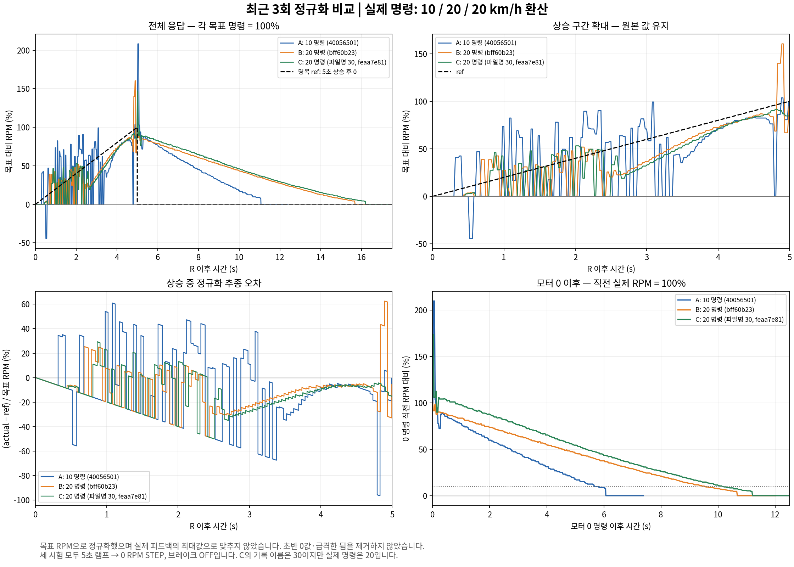

# 최근 3개 모터 로그 정규화 비교

각 첫 목표 RPM을 100%로 하고 R 시각을 맞췄다. 실제 최대값으로 정규화하지 않아 목표 미달과 튐이 그대로 드러난다.
모터 0 이후 곡선은 별도로 0 명령 직전 측정 RPM을 100%로 맞췄다.
**C는 파일명에 30이 들어 있지만 설정과 송신 명령은 20 km/h 환산이다.**
셋 다 5초 상승 램프, 끝 목표 0, 전환시간 0, 유지시간 0, 정상 완료 브레이크 OFF다.

| 기록 | 실제 목표 (RPM) | 상승 정규화 RMSE | 0 명령 직전 도달률 | 상승 중 최대 기록값/목표 | 0 후 10% 이하¹ | 정지 확인² |
| --- | ---: | ---: | ---: | ---: | ---: | ---: |
| A (10 명령) | 112.88 | 29.99% | 99.2% | 103.7% | 5.67s | 6.58s |
| B (20 명령) | 225.75 | 19.00% | 94.4% | 160.4% | 9.53s | 11.21s |
| C (20 명령) | 225.75 | 18.25% | 84.6% | 91.7% | 10.15s | 11.71s |

¹ 0 명령 직전 측정값의 10% 이하로 0.2초 연속 유지한 최초 구간 시작. PC 수신시각 기준이다.
² RPM 절댓값 ≤1이 0.5초 지속되어 확인된 시각. 모두 모터 0 명령 이후 시간이며 기계식 제동은 제외했다.

상승 중 오차는 C와 B가 A보다 작지만, 끝점 도달률은 A > B > C다. 따라서 한 지표로 전체 우열을 정하지 않는다.
B에는 목표 대비 약 160%의 큰 순간 기록이 있으며, 세 기록 모두 초반 0값·급격한 상하 변화가 반복된다.
원본을 그대로 포함한 지표다. 실제 제어 진동인지 피드백 측정·전송 문제인지 이 로그만으로 확정할 수 없다.
유지 구간이 없어 끝점 값을 정상상태 오차로 부르지 않는다. 부하·노면·배터리·게인 동일 여부도 별도 확인이 필요하다.

## 사용한 기록

- A: `20261024T143456-40056501-15초10키로-trial1`
- B: `20261024T143612-bff60b23-20키로5초-trial1`
- C: `20261024T144141-feaa7e81-30키로5초-trial1`

실행: doc에서 `python compare_normalized_motor_trials.py`. PNG/PDF, 정규화 CSV, 지표와 입력 해시는 같은 폴더에 저장한다.
