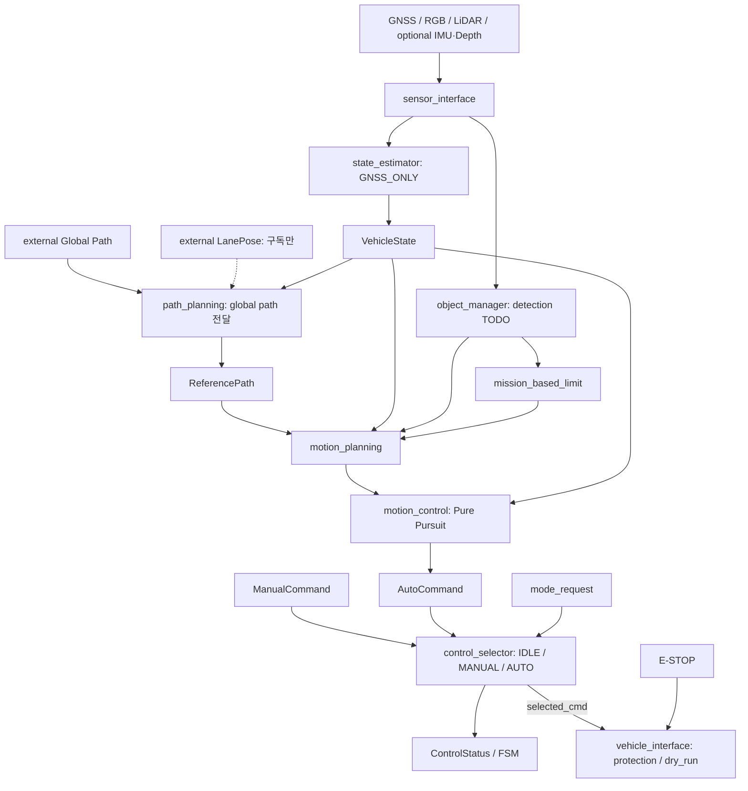
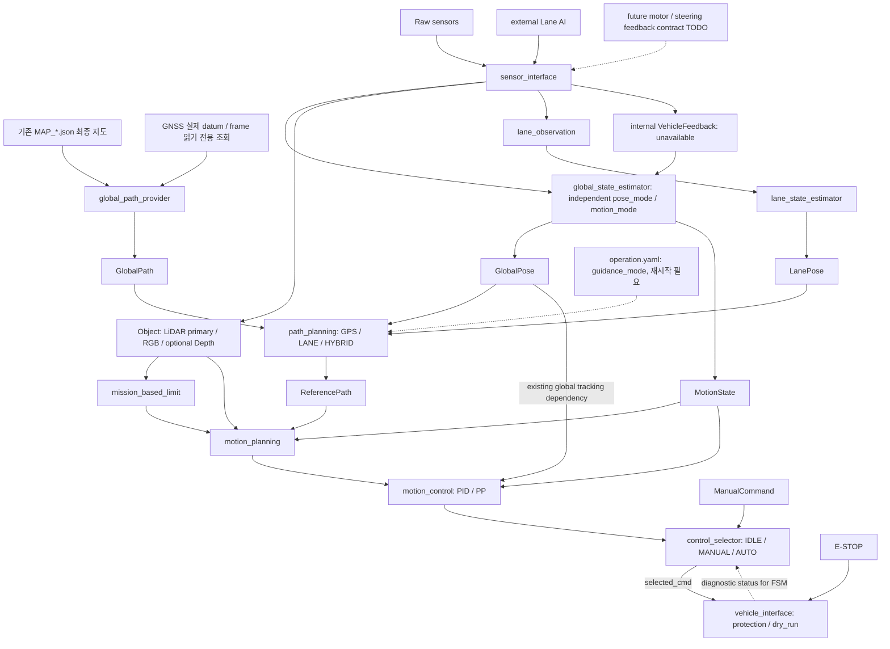
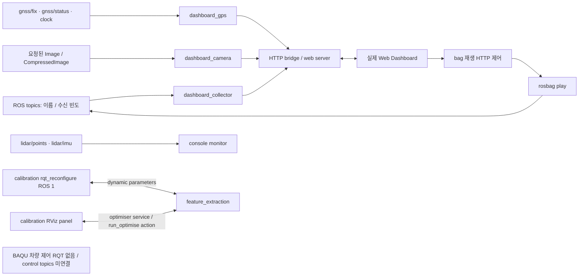
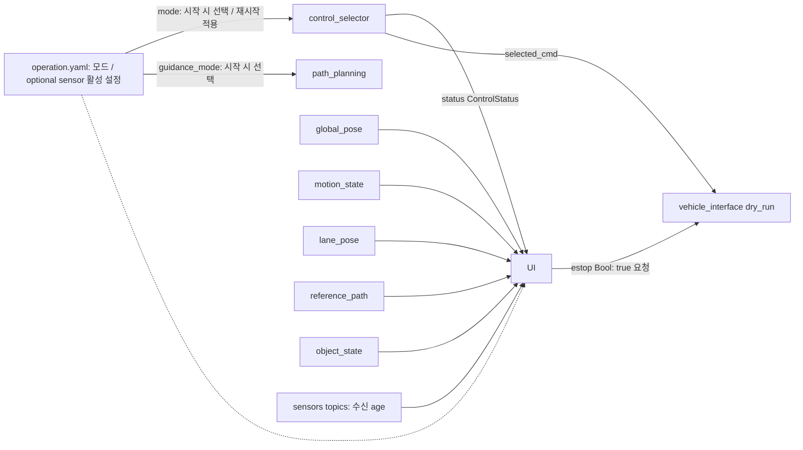

# Guidance Mode / GUI 설계 기록

이 문서의 AFTER control_manager는 실제 구현입니다. AFTER RQT는 **설계안**이며 GUI 소스는 수정하지 않았습니다.
Guidance는 path_planning_node가 소유하고, ControlMode는 control_selector_node가 소유합니다.
현재 상태 출력은 global_state_estimator와 lane_state_estimator가 맡습니다. README 및 estimators.md를 참고합니다. HYBRID는 GPS+Lane guidance이며 localization fusion과 다릅니다.

## BEFORE control_manager (변경 전 source)

아래는 초기 센서/planning 구조를 설명하는 그림이며, Lane 메시지와 후반 command path는 현재 명칭/구조로 갱신했습니다.



## AFTER control_manager (상태 분리 + ingress 현재 구현)



LANE의 planner dependency는 LanePose만입니다. Lane/Hybrid 알고리즘과 local-path controller adapter는 미구현입니다.

## 실제 GUI 조사 근거 (READ ONLY)

- BAQU 차량 제어 전용 RQT plugin 구현은 검색에서 발견되지 않았습니다.
- `dashboard/dashboard/index.html`: 실제 웹 화면. 데이터 사용량, ROS 토픽, GPS 시각화,
  ROS bag 재생/정지/반복/배속, GPS 배경 맵, 배경 지도 생성, 카메라 토픽/Hz/ON-OFF.
  화면의 mode는 시각화 모드이며 Vehicle Control/Guidance enum이 아닙니다.
- `main/tools/dashboard_collector.py`: ROS topic 탐색/수신 빈도를 HTTP로 전송합니다.
  `dashboard_gps.py`: `/gnss/fix`, `/gnss/status`, `/clock`을 구독합니다.
  `dashboard_camera.py`: 요청된 Image/CompressedImage를 구독하여 웹으로 전달합니다.
  `dashboard/config.yaml`에는 ROS 토픽 표시 그룹이 있습니다.
- `main/src/monitor/monitor/config.py`: GUI가 아닌 console monitor. 기본 data 구독은
  `/lidar/points`, `/lidar/imu`이며 ControlStatus를 실제 연결하지 않습니다.
- `calibration/src/camera_bringup/launch/extrinsic.launch`: ROS 1의 외부 `rqt_reconfigure` 실행 설정.
  `calibration/src/cam_lidar_calibration/cfg/params.yaml`: feature_extraction bounds 등 파라미터.
  `calibration/src/cam_lidar_calibration/src/cam_lidar_panel.cpp`와 `plugin_description.xml`:
  실제 Qt **RViz panel**, Capture Background / Capture sample / Discard last sample / Optimise / 결과 표시.
  차량 제어 RQT 패널과는 다릅니다. `/optimiser` service 및 `run_optimise` action 사용.

## BEFORE RQT / 실제 기존 GUI wireframe

RQT 차량 화면은 없으므로 가상의 BEFORE 제어 화면을 만들지 않습니다.
아래는 source에 있는 웹 UI와 calibration GUI를 간략히 옮긴 것입니다(화면 캡처 아님).

```text
┌─ 기존 BAQU 차량 제어 RQT ─────────────────────┐
│ 해당 전용 구현 없음                           │
└──────────────────────────────────────────────┘
┌─ 실제 웹 대시보드 ────────────────────────────┐
│ 연결 / 사용 시간 / 데이터 사용량 / ROS 토픽    │
├───────────────────┬──────────────────────────┤
│ 시각화 모드       │ GPS 시각화 / 지도 편집    │
│ · ROS bag 보기    │                          │
│ · GPS 배경 맵     │ 카메라 토픽 / Hz / ON-OFF│
│ · 배경 지도 생성  │ 카메라 영상              │
│ 재생/정지/반복/배속│                          │
└───────────────────┴──────────────────────────┘
┌─ 별도 calibration (ROS 1) ────────────────────┐
│ rqt_reconfigure: feature_extraction parameters│
│ RViz: Background / Capture / Discard / Optimise│
└──────────────────────────────────────────────┘
```

## AFTER RQT (권장안만; 미구현)

미지원 HYBRID 시작 설정 예시입니다. 수치 `--`는 가짜 feedback이 아닌 미수신 표시입니다.

```text
┌─ BAQU Control (설계안) ───────────────────────┐
│ Vehicle Control: [IDLE] [MANUAL] [AUTO]       │
│ Actual control / FSM: -- / --               │
├─────────────────────────────────────────────┤
│ Guidance config: HYBRID (변경 후 재시작)    │
│ * LANE/HYBRID NOT_IMPLEMENTED: AUTO stop    │
│ ReferencePath: empty                       │
├─────────────────────────────────────────────┤
│ Localization: GNSS / GNSS_IMU*                     │
│ future fusion: NOT_IMPLEMENTED              │
│ GNSS / Lane / Path: validity + age / --     │
│ IMU / LiDAR / Depth: config + RX age / --   │
│ 수신 여부와 perception 유효성은 별도 표시    │
├─────────────────────────────────────────────┤
│ Vehicle: x / y / yaw / speed / yaw rate: -- │
│ Target: steer(rad) / speed(m/s) / brake: -- │
│ Feedback: speed=MotionState (valid일 때)   │
│ actual steering / brake: UNKNOWN           │
├─────────────────────────────────────────────┤
│ Safety / Fault / Reason / status age       │
│ [E-STOP 요청]                              │
└─────────────────────────────────────────────┘
```

Guidance는 시작 설정과 ReferencePath 유무를 표시하며 별도 상태 토픽은 없습니다.
Control 요청과 node가 보낸 상태 표시는 분리합니다. 상태가 만료되면 STALE/UNKNOWN을 표시합니다.
Optional sensor runtime toggle은 없습니다. config 활성 여부와 수신 age를 표시하더라도
그것이 fusion/detection의 성공이나 센서 물리 정상 여부를 뜻하지 않습니다.
센서 health/실제 외부 actuator feedback 계약은 미확정입니다. 내부 VehicleFeedback은 현재 invalid입니다.

## BEFORE RQT ↔ ROS topics (실제 존재하는 연결만)



이 그래프의 RQT 연결은 calibration parameter/service이며 신규 control topic 연결이 아닙니다.
Web Dashboard는 control_manager의 Guidance 및 arbitration 요청 UI를 갖고 있지 않습니다.

## AFTER RQT ↔ ROS topics (제안, GUI는 미구현)



`/control/status`는 유지하며 `/control/mode_request` 구독은 제거했습니다.
Vehicle Control은 operation.yaml의 mode=IDLE / MANUAL / AUTO로 시작 시 선택하며 변경 후 selector를 재시작합니다.
Guidance는 operation.yaml의 guidance_mode=GPS / LANE / HYBRID로 시작 시 선택하며 변경 후 재시작합니다.
별도 Guidance 요청/상태 토픽은 없으며 Path Planning의 출력은 ReferencePath 하나입니다.
상태 표시는 새 GlobalPose/MotionState 계약을 사용해야 합니다.
GUI는 단순 요청/표시 source이고 정지 판정 권한은 node/safety에 있습니다.
GUI가 없어도 source freshness 검사와 AUTO invalid guidance stop 경로는 유지됩니다.
