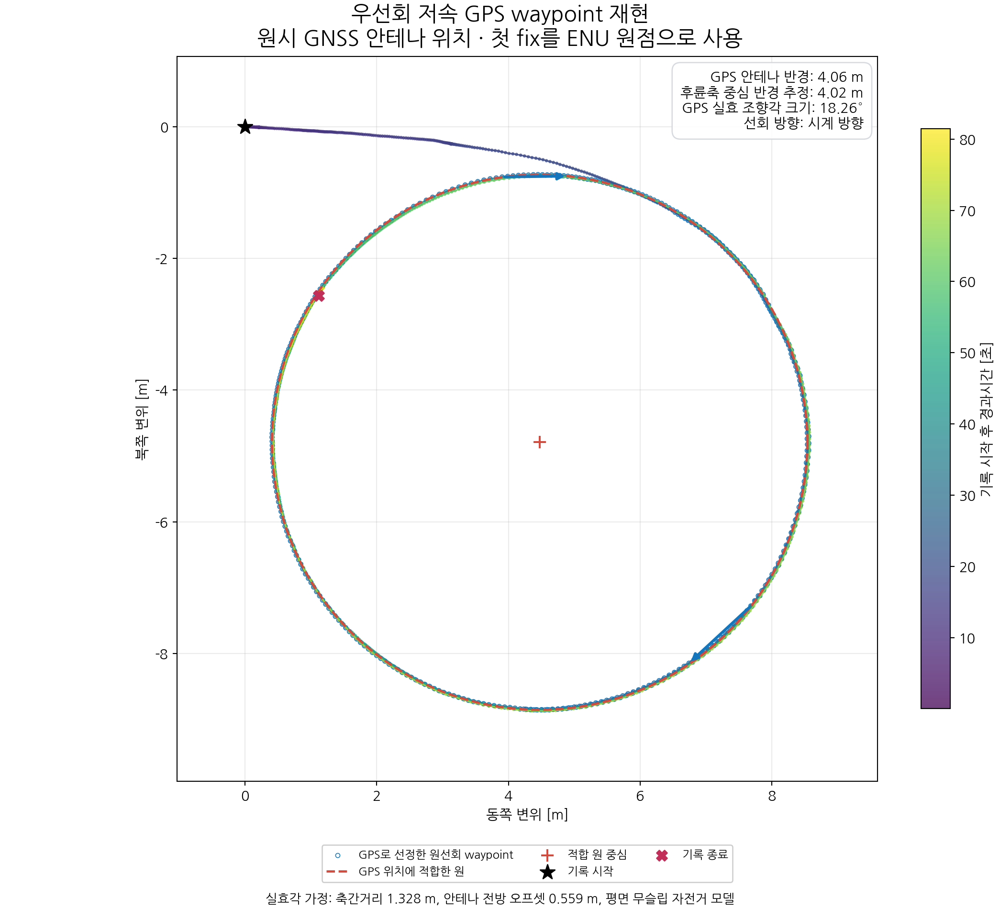
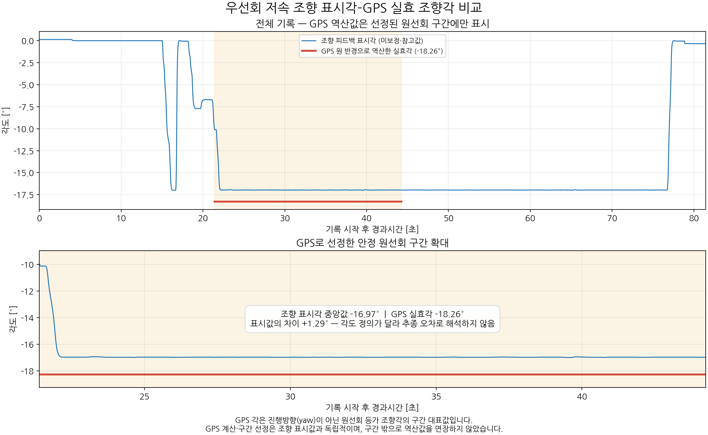

# 조향 우선회 저속 시험

2026-10-23 한국 시각에 수행한 시험이다. 시험명은 기록 종료 시 운영자가 입력한
`우선회 저속`을 따른다. 저속·고속은 시험명이며 실제 속도는 아래 GNSS 관측값을 사용한다.

## 기록 구간 및 저장 검증

- 현재 폴더명 `20261023_001659`은 한국 시각의 날짜와 시작시간이다.
- 원본 폴더: `main/log/vehicle_recorder/steering_angle/20261022T151659-ccde4375-우선회 저속/`.
- 전체 수신 구간: 2026-10-23T00:16:59.363+09:00 ~ 2026-10-23T00:18:20.822+09:00 (약 81.46초).
- 조향 수신 구간: 2026-10-23T00:16:59.363+09:00 ~ 2026-10-23T00:18:20.822+09:00.
- `metadata.json`: `review_status=accepted`, `complete=true`,
  `written=10598`, `dropped=0`, `pending=0`, `errors=[]`.
- JSONL 10,598건 모두 파싱 성공. metadata의 저장 건수 및 토픽별 CSV 건수와 일치한다.
- 기존 로그 7개 파일은 호스트 원본과 SHA-256이 일치한다. 원본 CSV·JSONL·metadata는 변경하지 않았다.
- 운영자의 정상 기록 선택과 기록기의 저장 완료 여부는 별개다. 내부 누락 0은 센서·UDP·DDS 전체의 무손실이나 측정 정확도를 보장하지 않는다.

| 토픽 | 기록 건수 | 수신시각 기준 평균 [Hz] | 최대 수신 간격 [ms] |
|---|---:|---:|---:|
| `/gnss/odom` | 1,630 | 20.00 | 284.59 |
| `/gnss/fix` | 1,630 | 20.00 | 284.66 |
| `/gnss/status` | 1,630 | 20.00 | 284.72 |
| `/steering_feedback` | 4,081 | 50.09 | 29.99 |
| `/motor_feedback` | 1,627 | 19.97 | 60.33 |

평균 주파수는 `(건수−1)/(마지막 수신시각−첫 수신시각)`이다. 기록기 PC monotonic 시각을 사용했다.
GNSS 상태 분포는 `{"4": 1630}`이며 `4`는 RTK Fixed다.
모터 토픽은 함께 기록된 항목의 건수만 확인했고 RPM 보정 분석은 수행하지 않았다.

## 조향 및 속도 관측

- 조향 피드백 유효 표시는 4,081/4,081건이다.
- 유효 조향 표시값 범위: -17.00 ~ +0.15°.
- 조향 MCU tick 고유값 4,081개, 연속 중복 0건,
  wrap을 제외한 역행 0건이다.
- 전체 GNSS 속도 범위: 0.006 ~ 7.984 km/h.
- 아래 선정 구간의 조향 표시값 중앙값: -16.97°.
- 같은 구간의 유효 조향 표시값 범위: -17.00 ~ -9.95°.

조향 표시값은 보드의 환산각이다. 유효 표시나 GPS 결과와의 일치만으로 영점·물리 바퀴각 보정이
검증되었다고 판단하지 않는다. MCU tick은 PC·GNSS 시계와 동기화되어 있지 않다.

## GPS waypoint 및 원선회 실효각

전체 `/gnss/fix`를 WGS84 ECEF에서 ENU로 변환했다. 첫 fix가 ENU 원점이며 **GNSS 안테나 궤적**이다.
색은 기록 시작 후 경과시간, 별·X는 처음·마지막 위치, 파란 테두리는 선정 위치,
점선은 적합 원을 뜻한다. 그래프 시간 원점은 첫 `/gnss/odom` 수신시각이다.

조향 표시값이나 목표각 17.01°는 원선회 구간 선정·원 적합에 사용하지 않았다.
GNSS 상태 4, 속도 0.7 m/s 이상을 후보로 사용한다. 수신시각 기준 최근접 상태는 0.3초,
속도 샘플은 0.15초 이내여야 한다. 속도는 GNSS odom을 선형 보간했다.
RANSAC 2,500회(seed 261022), 반경 탐색 0.75~100 m, 방사 오차 0.10 m로 지배적인 원을 찾고
기하학적 최소제곱으로 재적합한다. 후보 사이 공백이 1초를 넘으면 나누고,
한 바퀴 이상인 가장 긴 구간에서 양 끝 0.5초씩 제외했다. 이 절차는 기존 10월 21일 GPS 분석과 같다.

| 항목 | 결과 |
|---|---:|
| 선정 구간 KST | 2026-10-23T00:17:20.757+09:00 ~ 2026-10-23T00:17:43.606+09:00 |
| 첫 odom 수신 후 구간 | 21.394 ~ 44.244초 |
| 선정 위치 수 | 458 |
| 선정 속도 중앙값 | 5.65 km/h |
| 누적 회전 | -512.9° (시계 방향) |
| GPS 안테나 반경 | 4.063 m |
| 원 적합 방사방향 RMSE | 0.009 m |
| 후륜축 중심 반경 추정 | 4.024 m |
| GPS 실효 조향각 | -18.26° |

축간거리 L=1.328 m, 후륜축 중심에서 중심선상 안테나까지 전방 오프셋 a=0.559 m를
현재 `config/vehicle.yaml`에서 읽었다. 평면 무슬립 자전거 모델에서
`R_rear=sqrt(R_GPS²−a²)`, `|δ|=atan(L/R_rear)`를 사용했다. 부호는 GPS 회전 방향에 따른다.
실효각은 해당 궤적의 등가 조향각이며 개별 앞바퀴각의 직접 측정값이 아니다.
치수·안테나 위치·슬립·노면·속도가 결과에 영향을 준다. 적합 RMSE는 원형성 지표이며 GNSS 절대 정확도나 신뢰구간이 아니다.
원선회가 안정된 일부 구간의 결과이므로 전체 시간의 일정 반경을 의미하지 않는다.
선정은 GPS 궤적의 원형성을 기준으로 하므로 조향 피드백의 과도 구간이나 일시 변동이 포함될 수 있다.
선정 구간 전체에서 기계 끝단 또는 일정한 최대 조향을 유지했다는 사실까지 검증한 것은 아니다.

선정 기준의 방사 허용오차를 0.07/0.10/0.15/0.20/0.30 m로 바꿔 반복한 실효각 크기 범위는
18.26~18.26°다. 이 범위도 통계적 신뢰구간이 아니다.
다섯 기준 모두 한 바퀴 조건을 만족하는 구간을 찾았다.

선정 구간 시작부터 누적 회전으로 나눈 완주 회차만 따로 적합했다. 부분 회차는 제외했다.

| 완주 회차 | 속도 중앙값 [km/h] | 안테나 반경 [m] | 실효각 크기 [°] |
|---|---:|---:|---:|
| 1 | 5.58 | 4.060 | 18.27 |

## 조향 표시각과 GPS 실효각 비교

위 패널은 전체 기록, 아래 패널은 GPS로 선정한 원선회 구간이다.
파란 선은 유효 조향 피드백 표시각, 붉은 선은 선정 구간의 GPS 원 반경으로 역산한
실효각 대표값 -18.26°다. GPS 값은 순간 heading(yaw)이 아니며 구간 밖으로 연장하지 않았다.
표시각 중앙값과 GPS 실효각의 차이는 +1.29°이지만,
각도 정의와 보정 상태가 달라 이 차이를 곧바로 추종 오차로 해석하지 않는다.

이 자료 작성으로 최대각·기어비·펌웨어·PC 파라미터를 변경하지 않았다.
17.01° 채택 여부는 좌우·속도 조건을 함께 비교하여 별도로 판단한다.

## 재현 자료

워크스페이스 루트의 `test_runs/steering-figures-20261023/generate.py`가 생성 코드다.
같은 폴더의 `results.json`, `sensitivity.json`, `laps.json`, `gps_points.csv`, `manifest.json`에
수치·선정 위치·가정·입출력 해시를 보존했다. 호스트에서 오프라인으로 실행했으며 차량 명령은 송신하지 않았다.
